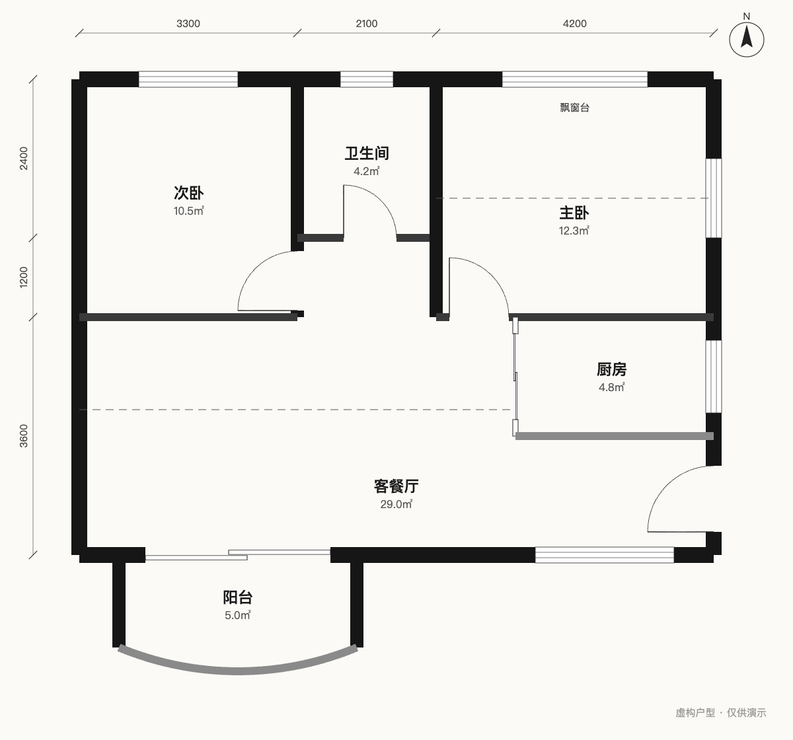
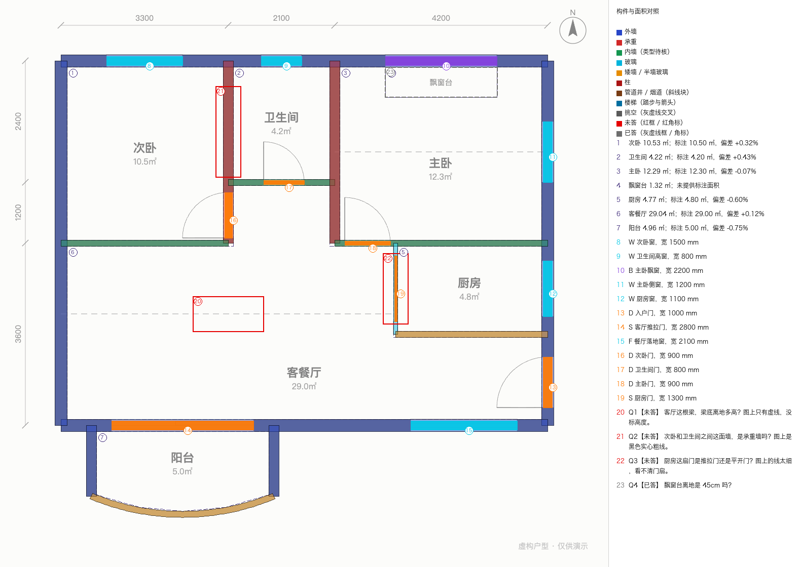
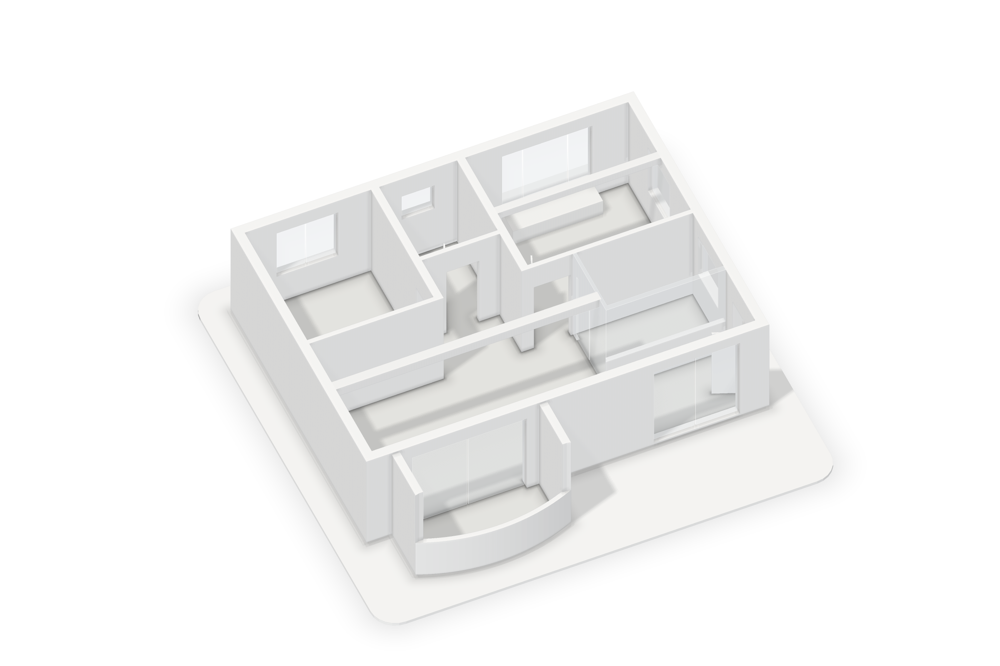
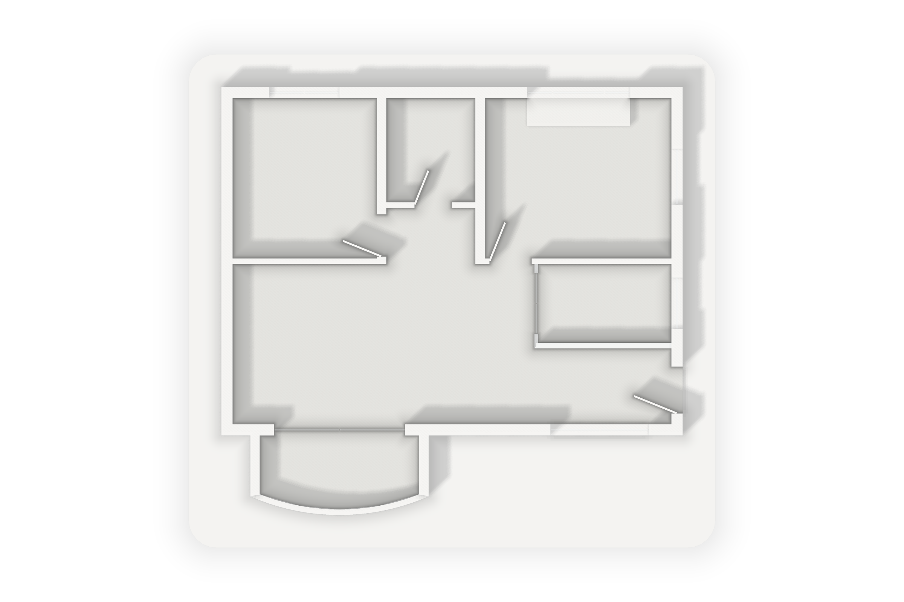
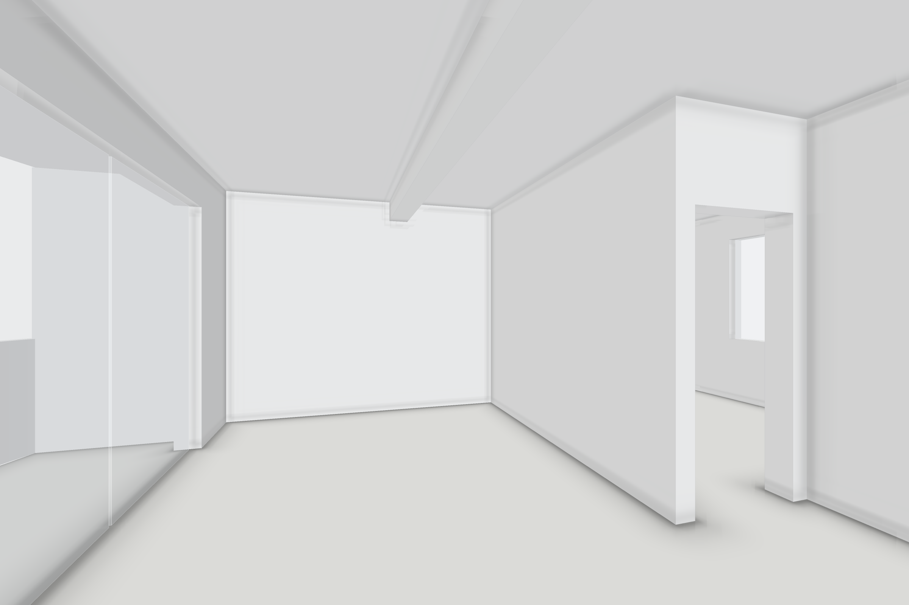
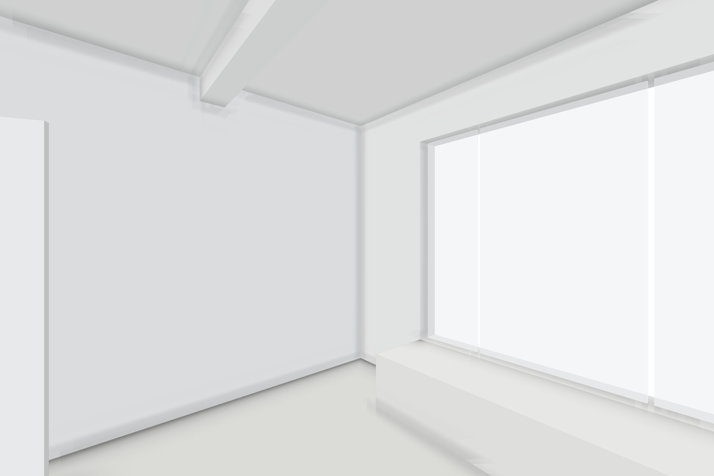

<picture>
  <source media="(prefers-color-scheme: dark)" srcset="assets/logo/see-lockup-dark.svg">
  <source media="(prefers-color-scheme: light)" srcset="assets/logo/see-lockup-light.svg">
  
</picture>

# see-your-home · 看见你的家

给 Agent 一张户型图，它帮你读出家的结构，交回一个能转着看的白模和几张白模图。用来自己确认想法、和设计师沟通，不是施工图。

源码公开，非商业免费使用。[English](README.en.md)

| 你给的户型图 | Agent 读出的结构，叠回原图核对 |
| --- | --- |
|  |  |

| 白模斜视 | 1.2 m 高俯视剖切 |
| --- | --- |
|  |  |

| 客厅平视（看电视墙） | 主卧平视（床头墙和飘窗） |
| --- | --- |
|  |  |

示例是虚构的两室户型，全部产物在 [examples/](examples/README.md)。

## 你会拿到

- **方案 JSON**：墙、门窗、梁、柱、管井、楼梯、层高、房间，复式按楼层分开。每个构件都记着是看到的、推断的还是不知道。
- **叠图**：读出的墙和门窗画回原图上，对不对一眼能看出来。
- **`.glb` 白模**：glTF 2.0 标准的三维文件，支持 glTF 的查看器和建模软件都能打开，比如 Blender 自带 glTF 导入。
- **白模图**：斜视、俯视剖切，以及你想看的房间平视。
- **要你确认的问题**：图上读不出来、又会改动结构的地方，第一轮一般 3–5 个。
- 想试改造（拆墙、开洞）的，另出改造后的模型和图；拆承重墙、外墙之前 Agent 会先问你。
- 想自己拿去生图的，同一个机位还能出深度图、线稿、分割图和每扇门窗的遮罩。

## 怎么用

### 1. 装上

需要 Node.js 20 以上；叠图要 Python 3 和 Pillow。NumPy 是 `extract_drawing.py` 需要的可选运行依赖，不随附；不使用提取脚本时无需它。Skill 不会自己装这些，缺什么 Agent 会先告诉你用途，你同意再装。

先把仓库下载到本机：`git clone https://github.com/ai-azhou/see-your-home.git`；不用 git 的话，在 [GitHub 页面](https://github.com/ai-azhou/see-your-home) 点 Code → Download ZIP。

然后把仓库里的 `skill/see-your-home/` 整个文件夹复制到下面的位置：

| 在哪用 | 只给自己用 | 只给某个项目用 | 依据 |
| --- | --- | --- | --- |
| Claude Code | `~/.claude/skills/see-your-home/` | 项目里的 `.claude/skills/see-your-home/` | [Claude Code Skills 文档](https://code.claude.com/docs/en/skills) |
| Codex | `~/.agents/skills/see-your-home/` | 项目里的 `.agents/skills/see-your-home/` | [OpenAI Build skills 文档](https://learn.chatgpt.com/docs/build-skills) |
| claude.ai | 在 Customize → Skills 上传 zip，并打开代码执行 | — | [Anthropic 上传说明](https://support.claude.com/en/articles/12512198-how-to-create-custom-skills) |

claude.ai 用的 zip 在仓库根目录运行 `python3 scripts/package-skill.py` 生成，产物是 `dist/see-your-home-skill.zip`，顶层是 `see-your-home/` 文件夹。

**还没实测的**：claude.ai 云端环境能不能跑 Node 20 和 Pillow，我们没有上传试过。其他支持 Skill 的 Agent，请按它自己的文档放目录，也没有实测。

### 2. 说一句话

把户型图发给 Agent，然后说：

> 用 see-your-home 读这张户型图，核对比例和结构，给我白模和几张白模图，再列出要我确认的问题。

之后可以接着说：

> 我想看主卧飘窗那边。

> 把次卧和客厅之间这面墙拆掉，看看改完的样子。

> 给我客厅这个角度的深度图和线稿，我自己拿去生图。

Agent 会先告诉你它打算怎么读、大概会问什么；最后的说明一屏以内，写清拿到了什么、怎么打开、要你确认哪几件事。

## 它不是什么

- 不是施工图。能不能拆、哪面是承重墙，以现场和专业人员的结论为准，不以这个结果为准。
- 不画家具、不配材质。白模只表现结构。
- 尺寸来自图上的标注和比例推算。图上没写、又推不出来的，会写进问题里问你，不会编一个数。
- 房间平视是自动挑的机位。很窄的房间（比如卫生间）平视看不全，机位说明里会照实写，配俯视或斜视看。

## 隐私

随附的脚本只读写你电脑上的文件，不联网、不上传、不收集使用数据。

但户型图发给云端 Agent（包括 claude.ai）时，图片本身会交给那个服务处理，这一步不是离线的，用不用由你决定。Skill 不会再把图转给任何其他服务。

## 给开发者

### 命令

下面在 Skill 目录里运行，输入输出可以用绝对路径。Agent 用的写法是在用户工作目录里运行、脚本写全路径，见[命令](skill/see-your-home/references/命令.md)：

```sh
node scripts/plan-cli.mjs validate 方案.json          # 校验，不能有 error
python3 scripts/overlay.py 原图.png 方案.json 叠图.png  # 叠图 + 逐间面积
node scripts/plan-cli.mjs stats 方案.json             # 数量和面积
node scripts/plan-cli.mjs export 方案.json 白模.glb    # GLB，加 --state renovated 出改造后
node scripts/plan-cli.mjs render 方案.json 图          # 西南、东北斜视和俯视剖切，2400×1600
node scripts/plan-cli.mjs cameras 方案.json           # 列出全部机位和中文说明
node scripts/plan-cli.mjs render 方案.json 图 --camera room:r-master:w-n
node scripts/plan-cli.mjs render 方案.json 素材 --camera room:r-living --passes clay,depth,lines,seg,openings
node scripts/plan-cli.mjs schema                      # 在当前目录写出 schema/plan.schema.json
```

`render` 还有 `--level`、`--section`、`--size`、`--transparent`、`--state`；每张图旁边有同名 `.camera.json`，交回给 `--camera` 能逐字节复现。

### 格式

- Skill 的 `references/` 是写给 Agent 的手册：[格式](skill/see-your-home/references/格式.md)、[读图](skill/see-your-home/references/读图.md)、[改造](skill/see-your-home/references/改造.md)、[命令](skill/see-your-home/references/命令.md)、[相机与素材通道](skill/see-your-home/references/相机与素材通道.md)、[交付](skill/see-your-home/references/交付.md)。这些文件由打包脚本从配套工具的手册同步过来，不在这里手改。
- 方案 JSON 是 v3，长度一律毫米，面积平方米：字段见[格式](skill/see-your-home/references/格式.md)，机器校验用 [plan.schema.json](skill/see-your-home/references/plan.schema.json)。
- 相机、坐标系和素材通道（16 位深度、ADE20K 色板分割、门窗实例遮罩）：[相机与素材通道.md](skill/see-your-home/references/相机与素材通道.md)。
- GLB 用米，Y 轴朝上；按构件类型合并成网格，构件 ID 记在节点名和 primitive 的 extras 里。普通查看器一般按类型整组选中，不能逐面墙单独选。玻璃是半透明材质。
- 改造记录写在 `changes` 里，原始结构不动；改造后的导出只重放 `confirmed`，`pending` 不生效，重放失败直接报错。

### 目录

| 路径 | 内容 |
| --- | --- |
| `skill/see-your-home/` | 要安装的 Skill：SKILL.md、references、scripts（打包好的 CLI、叠图脚本、离线 glTF 校验器） |
| `examples/two-bed/` | 主示例：输入、方案、全部产物和 SHA256SUMS |
| `tests/fixtures/` | 旧格式兼容回归用的样例 |
| `scripts/selftest.sh` | 离线自测：只复制 Skill 和示例输入到临时目录跑一遍，不联网、不装依赖 |
| `scripts/package-skill.py` | 生成 claude.ai 用的 zip；有手册源时先把手册同步进 `references/` |

自测：`bash scripts/selftest.sh`，可以用 `PYTHON=/path/to/python` 指定装了 Pillow 的解释器。

### 已知局限

- 渲染是纯 Node 的软件光栅化：近似环境光遮蔽和软阴影，没有光线追踪、反射和折射；玻璃只透一层。
- 多层户型的斜视按实际标高叠放，上层会挡住下层；看单层用 `--level`。
- 方向名按图纸坐标，不按 `north` 旋转。
- 房间平视的自动选位是打分挑出来的，不保证每间都好看；拍不好的会在说明里写明。

配套的户型工具查看器后续单独发布。

## 许可

- 源码公开，非商业免费使用。自有代码按 [PolyForm Noncommercial 1.0.0](LICENSE)；文档、示例和图片按 [CC BY-NC-SA 4.0](LICENSE-docs.md)。
- 作者：你的AI阿舟。按 PolyForm Noncommercial 1.0.0 的 Notices 条款，分发本软件的任何部分时须同时附上下面这行（原文也在 [NOTICE](NOTICE) 文件里，Skill 文件夹里有同样一份）：

  ```text
  Required Notice: Copyright 你的AI阿舟
  ```

- 商用需要另行书面授权，见 [COMMERCIAL.md](COMMERCIAL.md)。联系方式：邮箱 azhou.ai@proton.me；微信（中国大陆）ai_azhou；小红书 @你的AI阿舟（小红书号 azhou_ai）；抖音 @你的AI阿舟（抖音号 azhou.ai）。
- 欢迎提 issue，暂不接受外部代码贡献，见 [CONTRIBUTING.md](CONTRIBUTING.md)。

## 第三方声明

打包进 CLI 的第三方包、版本、许可和版权写在 [THIRD-PARTY-NOTICES.md](THIRD-PARTY-NOTICES.md)，许可全文照录。随附的 Khronos glTF 校验器保留自己的 LICENSE 和 NOTICES。Pillow 运行时需要，不随附。第三方组件仍受各自原许可约束。
